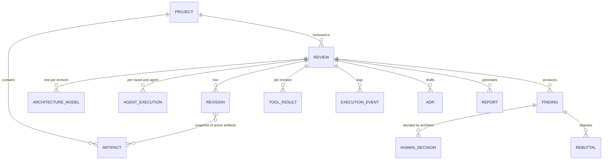

# Data model

All domain objects are Pydantic v2 models (`src/backend/models/domain.py`, `architecture.py`, `schemas.py`).
The application database stores each entity as one JSON document row with a few indexed key columns
(`src/backend/models/database.py`).

## Entities
| Entity | Table | Key fields |
| --- | --- | --- |
| `Project` | `projects` | `project_id, name, cloud_environment, scenario_id` |
| `ArchitectureArtifact` | `artifacts` | `artifact_id, project_id, filename, sha256, stored_path, detected_type, role, parse_status, active, superseded_by, requires_vision` |
| `Review` | `reviews` | `review_id, project_id, mode (demo/live), provider, model_id, status, current_round, max_rounds, architecture_revision, thread_id, recovery_note` |
| `ArchitectureRevision` | `revisions` | `revision_id, review_id, number, artifact_ids, change_notes, impact: ChangeImpact` |
| `ArchitectureModel` (wrapped) | `architecture_models` | `components, relationships, data_flows, constraints, nfrs, assumptions, security_controls, operational_tooling, deployment_regions, availability_dr, expected_workload, auth_mechanisms, unresolved, notes` |
| `AgentExecution` | `agent_executions` | `agent_id, round, status (PENDING/RUNNING/COMPLETED/FAILED/SKIPPED), started_at, completed_at, finding_count, tool_count, error, information_gaps, usage` |
| `Finding` | `findings` | see below |
| `ToolResult` (wrapped) | `tool_results` | `tool_id, tool_name, source_artifact_id, rule_id, execution_status, observed_value, expected_value, evidence_reference, raw_result_reference, timestamp` + `outcome, severity_hint, affected_component_ids` |
| `HumanDecision` | `human_decisions` | `decision_type (ACCEPT/DISPUTE/DEFER), justification, review_date, risk_owner, remediation_target, submitted` |
| `Rebuttal` | `rebuttals` | `dispute_decision_id, agent_id, stance, argument, evidence_refs, moderator_determination, outcome, exchange[]` |
| `ArchitectureDecisionRecord` | `adrs` | `number, title, context, options, decision, rationale, consequences, risks, owner, related_finding_ids, markdown, path` |
| `ReportArtifact` | `reports` | `format, path, filename, size_bytes, revision` |
| `ExecutionEvent` | `execution_events` | `seq, review_id, execution_id, agent_id, event_type, level, message, payload, timestamp` |

### Finding
`finding_id, review_id, agent_id, title, description, category, severity, confidence, evidence_level, affected_components,
source_references[], scenario, impact, recommendation, principle, principle_origin, validation_method, original_status,
assumptions, tool_result_refs, reasoning_summary, reasoning_by_agent` plus lifecycle:
`status, moderator_status, moderator_notes, contributing_agents, merged_from, original_severities, fingerprints,
first_seen_revision, last_seen_revision, first_seen_round, simulated, dispute_count, history[]`.
`history` is the audit trail (`PROPOSED, MERGED, MODERATED, ACCEPTED/DISPUTED/DEFERRED, REBUTTAL, MODERATOR_DETERMINATION,
RESOLVED_BY_REVISION, REOPENED, ...`).

### SourceReference
`artifact_id, filename, page, slide, section, line_start, line_end, excerpt, node_id, label, resource_path, tool_result_id`.

### Architecture model
`ArchitectureComponent`: `component_id, name, type, provider, configuration{}, provenance{property -> EXPLICIT|INFERRED|UNKNOWN},
dependencies, source_references, confidence`. Component IDs are stable: IaC resources use their address
(`aws_db_instance.orders`, `Deployment/payflow/api-gateway`, CloudFormation logical ID); diagram/text/vision-only components use
`diagram:<slug>`, `text:<slug>`, `vision:<slug>`, `llm:<slug>`. Secret-looking properties are stored as `<redacted>`.

## Enumerations
* Severity: `CRITICAL, HIGH, MEDIUM, LOW, INFORMATIONAL`
* Evidence level: `CONFIRMED, INFERRED, NEEDS_VALIDATION`
* Review status: `CREATED, UPLOADING, EXTRACTING, ANALYZING, MODERATING, AWAITING_HUMAN, REBUTTING, RE_REVIEWING, COMPLETED, COMPLETED_WITH_OPEN_RISKS, FAILED`
  (`UPLOADING` is part of the vocabulary; upload happens before a review exists and is shown per document via `parse_status`)
* Finding status: `OPEN, ACCEPTED, DISPUTED, REBUTTED, REJECTED, DEFERRED, REMEDIATION_PROPOSED, RESOLVED, VERIFIED`
* Document role: `PRIMARY_ARCHITECTURE, DIAGRAM, INFRASTRUCTURE, STANDARD, ADR, INCIDENT, SUPPORTING`

## Graph state vs application DB
The LangGraph state (`src/backend/graph/state.py::ReviewState`) holds serialised copies needed for the workflow
(model, moderated findings, decisions, rebuttals, events). The application DB is a *projection* used by the API/UI and
is updated by nodes as they progress. After a human resume the graph state is authoritative for findings and is synced to the DB.
